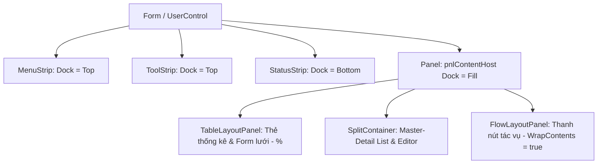

# Windows Forms Visual Programming Guidelines (.NET 10 / C# 13+)
## Hướng Dẫn Kỹ Thuật Toàn Diện Cho Đồ Án Môn Học Lập Trình Windows Forms (LTTQ)

> **Bộ Quy Chuẩn & Tài Liệu Thiết Kế Kỹ Thuật Đạt Chuẩn Rubric 10 Điểm**
>
> Tài liệu này cung cấp hướng dẫn kiến trúc, quy tắc bố cục trực quan (WYSIWYG) và các mẫu mã nguồn chuẩn (production-ready code patterns) cho đồ án môn học Windows Forms, thỏa mãn toàn bộ yêu cầu từ Chương 1 đến Chương 9 của đề cương học phần.

---

## Mục Lục
1. [Triết Lý Lập Trình Trực Quan (Visual-First & WYSIWYG)](#1-triết-lý-lập-trình-trực-quan-visual-first--wysiwyg)
2. [Kiến Trúc Phân 3 Tầng & Tổ Chức Solution (.NET 10 / C# 13+)](#2-kiến-trúc-phân-3-tầng--tổ-chức-solution-net-10--c-13)
3. [Bố Cục Desktop WinForms & Chống Va Chạm Controls (Zero Overlaps)](#3-bố-cục-desktop-winforms--chống-va-chạm-controls-zero-overlaps)
4. [Responsive Design, DataGridView & High-DPI Scaling](#4-responsive-design-datagridview--high-dpi-scaling)
5. [Kiến Trúc Đa Màn Hình: UserControl View Injection](#5-kiến-trúc-đa-màn-hình-usercontrol-view-injection)
6. [Xử Lý Sự Kiện, Phím Tắt & Validation Bằng ErrorProvider (Ch.4)](#6-xử-lý-sự-kiện-phím-tắt--validation-bằng-errorprovider-ch4)
7. [Lập Trình I/O, Async & Tác Vụ Nền Với ProgressBar (Ch.5)](#7-lập-trình-io-async--tác-vụ-nền-với-progressbar-ch5)
8. [Đồ Họa GDI+ & Trực Quan Hóa Dữ Liệu Dashboard (Ch.6)](#8-đồ-họa-gdi--trực-quan-hóa-dữ-liệu-dashboard-ch6)
9. [Cơ Sở Dữ Liệu: EF Core Migrations & ADO.NET Minh Họa (Ch.7)](#9-cơ-sở-dữ-liệu-ef-core-migrations--adonet-minh-họa-ch7)
10. [Xuất Báo Cáo Excel, PDF & In Ấn Trực Quan (Ch.8)](#10-xuất-báo-cáo-excel-pdf--in-ấn-trực-quan-ch8)
11. [Đóng Gói Publish, Logging Serilog & Bắt Lỗi Toàn Cục (Ch.9)](#11-đóng-gói-publish-logging-serilog--bắt-lỗi-toàn-cục-ch9)
12. [Phân Quyền Người Dùng & Ma Trận Rubric 10 Điểm](#12-phân-quyền-người-dùng--ma-trận-rubric-10-điểm)

---

## 1. Triết Lý Lập Trình Trực Quan (Visual-First & WYSIWYG)

Trong môn học Lập trình trực quan (LTTQ), **Visual Studio Form Designer là tiêu chuẩn cốt lõi**:
- **100% Designer Compatibility**: Khi double-click vào Form hoặc UserControl trong Solution Explorer, giao diện phải hiển thị hoàn chỉnh ngay lập tức.
- **Kéo - Thả trực tiếp**: Lập trình viên và giảng viên chấm bài có thể kéo control từ **Toolbox (`Ctrl + Alt + X`)** và chỉnh sửa thuộc tính trong **Properties Window (`F4`)**.
- **Quy tắc vàng phân chia code**:
  - `Form.Designer.cs`: Do Visual Studio quản lý qua phương thức `InitializeComponent()`. Chứa toàn bộ cây layout, khởi tạo control và thiết lập thuộc tính trực quan.
  - `Form.cs`: Do lập trình viên viết, chỉ chứa xử lý sự kiện (Click, Validating, KeyDown), data binding và lời gọi đến tầng nghiệp vụ (BLL Services). Tuyệt đối không sinh UI thủ công bằng code-behind (như viết hàm `BuildUI()` tự `new Button()` và tính tọa độ pixel).
- **Designer Guard**: Luôn đặt kiểm tra `DesignMode` để tránh gọi kết nối CSDL làm crash Designer:
  ```csharp
  if (System.ComponentModel.LicenseManager.UsageMode == System.ComponentModel.LicenseUsageMode.Designtime || this.DesignMode)
  {
      return;
  }
  ```

---

## 2. Kiến Trúc Phân 3 Tầng & Tổ Chức Solution (.NET 10 / C# 13+)

Không viết mã nghiệp vụ hay truy vấn SQL trực tiếp trong các sự kiện của Form. Solution được chia thành 3 project độc lập:

```
Solution: QuanLyVanTai.sln (hoặc QuanLyBanHang.sln)
├── QuanLyVanTai.UI              (Windows Forms App - .NET 10)
│    ├── Forms/                  (FrmMain.cs, FrmLogin.cs, FrmReportViewer.cs...)
│    ├── UserControls/           (UcDashboard.cs, UcTickets.cs, UcVehicles.cs...)
│    ├── Helpers/                (UiTheme.cs, ControlExtensions.cs)
│    └── Program.cs              (Entry point, High-DPI, Global Exception Handler)
├── QuanLyVanTai.BLL             (Class Library - .NET 10)
│    ├── Services/               (TicketService.cs, ReportService.cs, AuthService.cs)
│    ├── Interfaces/             (ITicketService.cs, IReportService.cs)
│    └── DTOs/                   (TicketDto.cs, DashboardStatsDto.cs - dùng C# record)
└── QuanLyVanTai.DAL             (Class Library - .NET 10)
     ├── Entities/               (Ticket.cs, Route.cs, UserAccount.cs)
     ├── Context/                (AppDbContext.cs - EF Core Code-First)
     ├── Migrations/             (Lịch sử EF Core Migrations)
     └── AdoDemos/               (AdoTicketRepository.cs - minh họa ADO.NET thuần)
```

### Minh Họa Tính Năng C# Hiện Đại (Chương 1–2)
```csharp
// DTOs định nghĩa bằng record (bất biến, so sánh theo giá trị)
public record TicketSummaryDto(int Id, string CustomerName, string RouteName, decimal Price, DateTime DepartureTime, string Status);

// Abstract class & Kế thừa
public abstract class BaseService<T> where T : class
{
    protected readonly AppDbContext _context;
    protected BaseService(AppDbContext context) => _context = context;
    public abstract Task<IReadOnlyList<T>> GetAllAsync();
}

// Pattern matching & Switch expression
public static string FormatStatusText(TicketStatus status) => status switch
{
    TicketStatus.Confirmed => "Đã xác nhận",
    TicketStatus.Pending   => "Chờ thanh toán",
    TicketStatus.Cancelled => "Đã hủy vé",
    _                      => "Không xác định"
};
```

---

## 3. Bố Cục Desktop WinForms & Chống Va Chạm Controls (Zero Overlaps)

### 3.1 Bố Cục Desktop Chuẩn Mực
Theo quy định của đề tài, không sử dụng cấu trúc website (header/sidebar/footer). Ứng dụng tuân theo chuẩn desktop Windows:
- **`MenuStrip` (`Dock = Top`)**: Menu chức năng có phím tắt (`&Hệ thống`, `&Danh mục`, `&Nghiệp vụ`, `&Báo cáo`, `&Trợ giúp`).
- **`ToolStrip` (`Dock = Top`)**: Thanh công cụ chứa các nút biểu tượng nhanh kèm ToolTip.
- **`StatusStrip` (`Dock = Bottom`)**: Thanh trạng thái chứa thông tin người dùng, quyền hạn, ngày giờ và `ToolStripProgressBar`.
- **Vùng làm việc trung tâm (`Dock = Fill`)**: Chứa `pnlContentHost` nhúng các `UserControl` hoặc quản lý dạng `MDI Parent` (`IsMdiContainer = true`).

### 3.2 Bộ Tứ Container Ngăn Ngừa Va Chạm Controls



1. **`TableLayoutPanel`**:
   - Sử dụng cho: Thẻ thống kê (Cards), các ô nhập liệu dạng cột chẵn.
   - Chia cột theo tỷ lệ `SizeType.Percent` (ví dụ: 4 thẻ KPI thì 4 cột đều là `25%`).
   - Mỗi ô chỉ chứa 1 control hoặc 1 container panel, cô lập tuyệt đối, không thể đè lên nhau.
2. **`FlowLayoutPanel`**:
   - Sử dụng cho: Cụm nút tác vụ (`btnThem`, `btnSua`, `btnXoa`, `btnIn`, `btnXuatExcel`).
   - Bắt buộc đặt `WrapContents = true` và `FlowDirection = LeftToRight`. Khi cửa sổ thu nhỏ, nút tự động xuống dòng an toàn.
3. **`SplitContainer`**:
   - Sử dụng cho: Giao diện Master-Detail (Danh sách bên trái, form chỉnh sửa bên phải).
   - Thiết lập `Panel1MinSize` và `Panel2MinSize` (ví dụ: `250px` và `350px`) để không thể kéo mất một bên.
4. **`Panel` kết hợp `Dock`**:
   - Sử dụng cho khung chính, phân định rõ ràng ranh giới hiển thị.

---

## 4. Responsive Design, DataGridView & High-DPI Scaling

### 4.1 MinimumSize & Overflow Safety
- Mọi Form phải đặt thuộc tính `MinimumSize` trong Designer (ví dụ: `new Size(1024, 650)` cho Form chính, `new Size(540, 420)` cho Dialog) để người dùng không thể thu nhỏ form gây biến dạng UI.
- Panel chứa nội dung chính (`pnlContentHost`) phải bật `AutoScroll = true`.

### 4.2 DataGridView Responsive Hoàn Chỉnh
```csharp
// Cấu hình trong Designer.cs hoặc SetupGrid()
this.dgvTickets.AutoSizeColumnsMode = DataGridViewAutoSizeColumnsMode.Fill;
this.dgvTickets.SelectionMode = DataGridViewSelectionMode.FullRowSelect;
this.dgvTickets.MultiSelect = false;
this.dgvTickets.ReadOnly = true;
this.dgvTickets.AllowUserToAddRows = false;

// Thiết lập tỷ lệ độ rộng (FillWeight) và độ rộng tối thiểu (MinimumWidth):
this.colId.FillWeight = 10F;
this.colId.MinimumWidth = 60;

this.colCustomerName.FillWeight = 30F;
this.colCustomerName.MinimumWidth = 140;

this.colRouteName.FillWeight = 25F;
this.colRouteName.MinimumWidth = 120;

this.colPrice.FillWeight = 15F;
this.colPrice.MinimumWidth = 90;

this.colStatus.FillWeight = 20F;
this.colStatus.MinimumWidth = 100;
```

### 4.3 High-DPI Support (.NET 10)
Trong file `Program.cs`:
```csharp
ApplicationConfiguration.Initialize();
Application.SetHighDpiMode(HighDpiMode.PerMonitorV2);
```

---

## 5. Kiến Trúc Đa Màn Hình: UserControl View Injection

Loại bỏ hoàn toàn việc xếp chồng các Panel lên nhau trên một Form duy nhất ("Z-Order Hell"). Mỗi màn hình nghiệp vụ là một file `UserControl` độc lập:

```csharp
public partial class FrmMain : Form
{
    private UserControl? _currentView;

    public FrmMain()
    {
        InitializeComponent();
    }

    /// <summary>
    /// Thay thế màn hình hiển thị trong vùng làm việc trung tâm một cách an toàn.
    /// </summary>
    public void SwitchView(UserControl newView)
    {
        if (newView == null) return;

        pnlContentHost.SuspendLayout();
        try
        {
            if (_currentView != null)
            {
                pnlContentHost.Controls.Remove(_currentView);
                _currentView.Dispose();
                _currentView = null;
            }

            newView.Dock = DockStyle.Fill;
            pnlContentHost.Controls.Add(newView);
            newView.BringToFront();
            _currentView = newView;
        }
        finally
        {
            pnlContentHost.ResumeLayout();
        }
    }

    private void mnuNghiepVuBanVe_Click(object sender, EventArgs e)
    {
        SwitchView(new UcManageTicket());
    }

    private void mnuDashboard_Click(object sender, EventArgs e)
    {
        SwitchView(new UcDashboardOverview());
    }
}
```

---

## 6. Xử Lý Sự Kiện, Phím Tắt & Validation Bằng ErrorProvider (Ch.4)

### 6.1 Validation Chuẩn Với `ErrorProvider`
```csharp
private void txtSoDienThoai_Validating(object sender, CancelEventArgs e)
{
    string sdt = txtSoDienThoai.Text.Trim();
    if (string.IsNullOrEmpty(sdt))
    {
        errorProviderMain.SetError(txtSoDienThoai, "Số điện thoại không được để trống!");
        e.Cancel = true;
    }
    else if (!System.Text.RegularExpressions.Regex.IsMatch(sdt, @"^0\d{9}$"))
    {
        errorProviderMain.SetError(txtSoDienThoai, "Số điện thoại phải gồm 10 chữ số và bắt đầu bằng số 0!");
        e.Cancel = true;
    }
    else
    {
        errorProviderMain.SetError(txtSoDienThoai, string.Empty);
    }
}
```

### 6.2 Phím Tắt & Realtime Search Debounce
```csharp
// 1. Phím Enter nhảy sang ô tiếp theo
private void FormInput_KeyDown(object sender, KeyEventArgs e)
{
    if (e.KeyCode == Keys.Enter)
    {
        this.SelectNextControl(this.ActiveControl, true, true, true, true);
        e.Handled = true;
        e.SuppressKeyPress = true;
    }
}

// 2. Realtime Search Debounce (350ms) dùng Timer
private readonly System.Windows.Forms.Timer _searchTimer = new() { Interval = 350 };

private void SetupSearchDebounce()
{
    _searchTimer.Tick += async (s, e) =>
    {
        _searchTimer.Stop();
        await ExecuteSearchAsync(txtSearch.Text.Trim());
    };
}

private void txtSearch_TextChanged(object sender, EventArgs e)
{
    _searchTimer.Stop();
    _searchTimer.Start();
}
```

---

## 7. Lập Trình I/O, Async & Tác Vụ Nền Với ProgressBar (Ch.5)

Xử lý tác vụ nặng (nhập/xuất dữ liệu lớn) hoàn toàn bất đồng bộ, cập nhật tiến độ lên `ToolStripProgressBar` trên `StatusStrip` mà không đóng băng giao diện:

```csharp
private async void btnImportExcel_Click(object sender, EventArgs e)
{
    using var openFileDialog = new OpenFileDialog
    {
        Filter = "Excel Files (*.xlsx)|*.xlsx|CSV Files (*.csv)|*.csv",
        Title = "Chọn file dữ liệu để nhập"
    };

    if (openFileDialog.ShowDialog() != DialogResult.OK) return;

    btnImportExcel.Enabled = false;
    toolStripProgressBar.Visible = true;
    toolStripProgressBar.Value = 0;

    var progress = new Progress<int>(percent =>
    {
        toolStripProgressBar.Value = percent;
        statusLabel.Text = $"Đang xử lý dữ liệu: {percent}%...";
    });

    try
    {
        string filePath = openFileDialog.FileName;
        int totalRecords = await Task.Run(() => _ticketService.ImportTicketsFromExcel(filePath, progress));
        MessageBox.Show($"Nhập thành công {totalRecords} vé!", "Hoàn thành", MessageBoxButtons.OK, MessageBoxIcon.Information);
        await LoadDataAsync();
    }
    catch (Exception ex)
    {
        MessageBox.Show($"Lỗi trong quá trình nhập dữ liệu: {ex.Message}", "Lỗi", MessageBoxButtons.OK, MessageBoxIcon.Error);
    }
    finally
    {
        btnImportExcel.Enabled = true;
        toolStripProgressBar.Visible = false;
        statusLabel.Text = "Sẵn sàng";
    }
}
```

---

## 8. Đồ Họa GDI+ & Trực Quan Hóa Dữ Liệu Dashboard (Ch.6)

### 8.1 Vẽ Biểu Đồ Cột Bằng GDI+ (Bật DoubleBuffered Chống Nhấp Nháy)
```csharp
public class DoubleBufferedPanel : Panel
{
    public DoubleBufferedPanel()
    {
        this.DoubleBuffered = true;
        this.SetStyle(ControlStyles.AllPaintingInWmPaint | ControlStyles.UserPaint | ControlStyles.OptimizedDoubleBuffer, true);
        this.UpdateStyles();
    }
}

// Trong sự kiện Paint của Panel biểu đồ:
private void pnlChart_Paint(object sender, PaintEventArgs e)
{
    Graphics g = e.Graphics;
    g.SmoothingMode = System.Drawing.Drawing2D.SmoothingMode.AntiAlias;

    var data = _dashboardService.GetMonthlyRevenue(); // Lấy dữ liệu thật từ CSDL
    if (data.Count == 0) return;

    int margin = 40;
    int chartWidth = pnlChart.Width - margin * 2;
    int chartHeight = pnlChart.Height - margin * 2;
    decimal maxVal = data.Max(x => x.Revenue);
    if (maxVal == 0) maxVal = 1;

    int barWidth = chartWidth / data.Count - 15;

    for (int i = 0; i < data.Count; i++)
    {
        int barHeight = (int)((data[i].Revenue / maxVal) * chartHeight);
        int x = margin + i * (barWidth + 15);
        int y = pnlChart.Height - margin - barHeight;

        using var brush = new SolidBrush(Color.FromArgb(41, 128, 185));
        g.FillRectangle(brush, x, y, barWidth, barHeight);

        // Nhãn tháng và doanh thu
        g.DrawString(data[i].Month, this.Font, Brushes.Black, x, pnlChart.Height - margin + 5);
        g.DrawString($"{data[i].Revenue:N0}", this.Font, Brushes.DarkSlateGray, x - 5, y - 18);
    }
}
```

Hoặc tích hợp thư viện **LiveCharts2** (`LiveChartsCore.SkiaSharpView.WinForms`) để tạo biểu đồ tương tác hiện đại.

---

## 9. Cơ Sở Dữ Liệu: EF Core Migrations & ADO.NET Minh Họa (Ch.7)

### 9.1 Entity Framework Core (Code First & Migrations)
```csharp
public class AppDbContext : DbContext
{
    public DbSet<Ticket> Tickets => Set<Ticket>();
    public DbSet<Route> Routes => Set<Route>();
    public DbSet<UserAccount> Users => Set<UserAccount>();

    protected override void OnModelCreating(ModelBuilder modelBuilder)
    {
        // Quan hệ 1-N có khóa ngoại
        modelBuilder.Entity<Ticket>()
            .HasOne(t => t.Route)
            .WithMany(r => r.Tickets)
            .HasForeignKey(t => t.RouteId)
            .OnDelete(DeleteBehavior.Restrict);
    }
}

// Truy vấn bất đồng bộ có Eager Loading:
public async Task<List<Ticket>> GetActiveTicketsAsync()
{
    return await _context.Tickets
        .Include(t => t.Route)
        .Where(t => t.Status == TicketStatus.Confirmed)
        .OrderByDescending(t => t.CreatedAt)
        .ToListAsync();
}
```

### 9.2 Minh Họa ADO.NET Thuần (Đối Chiếu Theo Yêu Cầu Chương 7)
Xây dựng tối thiểu 1 chức năng dùng ADO.NET thuần để so sánh hiệu năng với EF Core:
```csharp
public async Task<DataTable> SearchTicketsAdoAsync(string keyword, decimal minPrice)
{
    var dt = new DataTable();
    using var conn = new SqlConnection(_connectionString);
    using var cmd = new SqlCommand(@"
        SELECT t.Id, t.CustomerName, r.RouteName, t.Price, t.DepartureTime, t.Status
        FROM Tickets t
        INNER JOIN Routes r ON t.RouteId = r.Id
        WHERE (@Keyword = '' OR t.CustomerName LIKE '%' + @Keyword + '%')
          AND t.Price >= @MinPrice", conn);

    cmd.Parameters.AddWithValue("@Keyword", keyword);
    cmd.Parameters.AddWithValue("@MinPrice", minPrice);

    await conn.OpenAsync();
    using var reader = await cmd.ExecuteReaderAsync();
    dt.Load(reader);
    return dt;
}
```

---

## 10. Xuất Báo Cáo Excel, PDF & In Ấn Trực Quan (Ch.8)

### 10.1 Xuất Excel Với ClosedXML
```csharp
public void ExportTicketsToExcel(List<TicketSummaryDto> data, string savePath)
{
    using var workbook = new ClosedXML.Excel.XLWorkbook();
    var worksheet = workbook.Worksheets.Add("BaoCaoDoanhThu");

    worksheet.Cell(1, 1).Value = "BÁO CÁO DOANH THU VÉ";
    worksheet.Cell(1, 1).Style.Font.Bold = true;
    worksheet.Cell(1, 1).Style.Font.FontSize = 16;

    // Header bảng
    string[] headers = ["Mã vé", "Khách hàng", "Tuyến đường", "Giá vé (VNĐ)", "Giờ khởi hành", "Trạng thái"];
    for (int i = 0; i < headers.Length; i++)
    {
        worksheet.Cell(3, i + 1).Value = headers[i];
        worksheet.Cell(3, i + 1).Style.Font.Bold = true;
        worksheet.Cell(3, i + 1).Style.Fill.BackgroundColor = ClosedXML.Excel.XLColor.FromArgb(220, 230, 242);
    }

    // Dữ liệu
    for (int row = 0; row < data.Count; row++)
    {
        var item = data[row];
        worksheet.Cell(row + 4, 1).Value = item.Id;
        worksheet.Cell(row + 4, 2).Value = item.CustomerName;
        worksheet.Cell(row + 4, 3).Value = item.RouteName;
        worksheet.Cell(row + 4, 4).Value = item.Price;
        worksheet.Cell(row + 4, 5).Value = item.DepartureTime.ToString("dd/MM/yyyy HH:mm");
        worksheet.Cell(row + 4, 6).Value = item.Status;
    }

    worksheet.Columns().AdjustToContents();
    workbook.SaveAs(savePath);
}
```

### 10.2 Xem Trước Bản In (Print Preview)
Tích hợp `PrintDocument` và `PrintPreviewDialog` trong WinForms để người dùng xem trước hóa đơn trước khi in ra máy in thực.

---

## 11. Đóng Gói Publish, Logging Serilog & Bắt Lỗi Toàn Cục (Ch.9)

### 11.1 Cấu Hình Logging & Bắt Ngoại Lệ Trong `Program.cs`
```csharp
static class Program
{
    [STAThread]
    static void Main()
    {
        // 1. Cấu hình Serilog ghi file
        Log.Logger = new LoggerConfiguration()
            .MinimumLevel.Information()
            .WriteTo.File("logs/quanlyvantai-.txt", rollingInterval: RollingInterval.Day)
            .CreateLogger();

        // 2. Bắt lỗi toàn cục giao diện UI Thread
        Application.SetUnhandledExceptionMode(UnhandledExceptionMode.CatchException);
        Application.ThreadException += (s, e) =>
        {
            Log.Error(e.Exception, "Lỗi UI Thread Unhandled Exception");
            MessageBox.Show($"Đã xảy ra lỗi: {e.Exception.Message}\nVui lòng kiểm tra log!", "Lỗi Hệ Thống", MessageBoxButtons.OK, MessageBoxIcon.Error);
        };

        // 3. Bắt lỗi AppDomain nền
        AppDomain.CurrentDomain.UnhandledException += (s, e) =>
        {
            Log.Fatal(e.ExceptionObject as Exception, "Lỗi Nghiêm Trọng AppDomain");
        };

        try
        {
            ApplicationConfiguration.Initialize();
            Application.SetHighDpiMode(HighDpiMode.PerMonitorV2);
            Application.Run(new FrmLogin());
        }
        finally
        {
            Log.CloseAndFlush();
        }
    }
}
```

### 11.2 Lệnh Đóng Gói Ứng Dụng (Self-Contained)
```bash
dotnet publish -c Release -r win-x64 --self-contained true -p:PublishSingleFile=true -o ./publish
```
Thư mục `./publish` tạo ra file `.exe` chạy độc lập trên bất kỳ máy Windows nào mà không cần cài đặt thêm .NET SDK.

---

## 12. Phân Quyền Người Dùng & Ma Trận Rubric 10 Điểm

### 12.1 Ma Trận Phân Quyền (Tối Thiểu 2 Vai Trò)
- **Màn hình đăng nhập (`FrmLogin`)**: Kiểm tra tên đăng nhập, mật khẩu (mã hóa SHA-256) từ bảng `Users` trong SQL Server.
- **Phân quyền giao diện**:
  - Khi đăng nhập với vai trò **Nhân viên / Người dùng**: Ẩn hoặc disable menu Quản trị tài khoản, Dashboard quản lý, cấu hình hệ thống.
  - Khi đăng nhập với vai trò **Quản trị viên / Quản lý**: Kích hoạt toàn bộ tính năng và hiển thị Dashboard số liệu tổng quan.

### 12.2 Bảng Đối Chiếu Rubric 10 Điểm

| Tiêu Chí | Yêu Cầu Kỹ Thuật Đạt Điểm Tối Đa | Điểm |
| :--- | :--- | :---: |
| **1. Kiến trúc & OOP (Ch.1–2)** | 3 tầng UI/BLL/DAL tách biệt; áp dụng interface, kế thừa, record, LINQ; >= 2 NuGet packages. | **1.0** |
| **2. Giao diện WinForms (Ch.3)** | 100% Designer WYSIWYG; MenuStrip/ToolStrip/StatusStrip chuẩn desktop; >= 8 controls; DataGridView FillWeight; responsive không đè nút. | **1.0** |
| **3. Xử lý sự kiện (Ch.4)** | ErrorProvider validate đầy đủ; phím tắt ShortcutKeys; Enter chuyển ô; debounce tìm kiếm; data binding ổn định. | **1.0** |
| **4. I/O & Async (Ch.5)** | Import/Export Excel/CSV/JSON; tác vụ nặng chạy Task.Run có ProgressBar, giao diện không đơ. | **1.0** |
| **5. Đồ họa GDI+ (Ch.6)** | Biểu đồ Dashboard lấy dữ liệu thật từ CSDL, bật DoubleBuffered chống flicker, tự co giãn theo form. | **0.5** |
| **6. CSDL EF Core & ADO (Ch.7)** | CRUD hoàn chỉnh bằng EF Core Migrations; quan hệ khóa ngoại (Include); có minh họa ADO.NET thuần. | **2.0** |
| **7. Báo cáo & In ấn (Ch.8)** | Xuất báo cáo Excel (ClosedXML) và PDF theo bộ lọc ngày/giá trị; có xem trước bản in (PrintPreviewDialog). | **1.5** |
| **8. Logging & Deploy (Ch.9)** | Publish Self-Contained chạy máy khác; Serilog ghi file; bắt lỗi toàn cục; (gọi REST API ngoài). | **1.0** |
| **9. Báo cáo & Phân quyền** | Phân quyền 2 vai trò; báo cáo kiến trúc kèm ERD; demo bảo vệ trôi chảy. | **1.0** |
| **TỔNG ĐIỂM** | **Đạt trọn vẹn điểm tối đa cho toàn bộ tiêu chí đồ án** | **10.0** |
